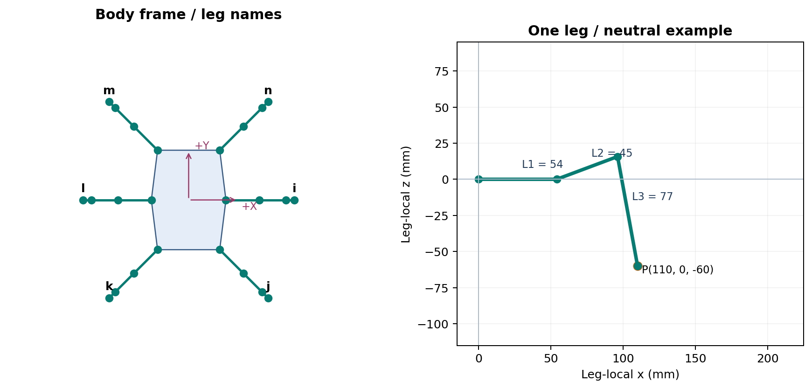
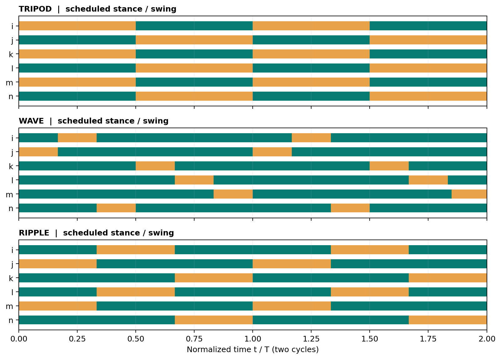

# Mô hình toán và thuật toán chuyển động Hexapod

Cấu hình thống nhất: coxa 54 mm, femur 45 mm, tibia 77 mm. Mã mô hình và giao diện điều khiển dùng cùng MotionController, FK/IK và nguồn cấu hình; firmware C++ được đối chiếu với lõi Python bằng kịch bản.

## 1. Hình học và hệ tọa độ

Hệ thân +X sang phải, +Y phía trước, +Z lên trên. Hệ chân có +x hướng ra ngoài theo hướng coxa trung hòa; +z lên trên. ID/thứ tự JointFrame là i,j,k,l,m,n, mỗi chân coxa/femur/tibia.

| ID | Vị trí | Mount X/Y (mm) | Hướng chân (độ) | Nhóm tripod |
|---|---|---|---:|---|
| i | Phải giữa | 60 / 0 | 0 | A |
| j | Phải sau | 50 / -80 | -45 | B |
| k | Trái sau | -50 / -80 | -135 | A |
| l | Trái giữa | -60 / 0 | 180 | B |
| m | Trái trước | -50 / 80 | 135 | A |
| n | Phải trước | 50 / 80 | 45 | B |

Các tọa độ gắn chân là mặc định của cấu hình điều khiển, cần đối chiếu CAD. Tâm coxa ở z=0 của thân. Điểm bàn chân trung hòa của mỗi hệ chân là (110,0,-60) mm; tư thế ngồi có độ cao 20 mm. Thông số lưu tại `config/robot_config.json`; không có bản sao cấu hình trong motion_model.



## 2. Động học thuận một chân

q1 là góc coxa, q2 góc đùi, q3 góc tương đối cẳng so với đùi. Góc toán học q2 dương nâng đùi; chọn nhánh gối q3 âm. Mốc q=(0,0,0) là chân duỗi thẳng theo +x, không phải mốc hiệu chỉnh servo.

$$r=L_1+L_2\cos q_2+L_3\cos(q_2+q_3)$$
$$x=r\cos q_1,\qquad y=r\sin q_1$$
$$z=L_2\sin q_2+L_3\sin(q_2+q_3)$$

Với q=(0,0,0), P=(176,0,0) mm. FK dùng tại `shared/common/leg_geometry.py`; cả lớp LegKinematics và API `motion_model.motion.fk` gọi cùng công thức này. `joint_chain` trả bốn điểm khớp để vẽ.

## 3. Động học nghịch một chân

$$q_1=\operatorname{atan2}(y,x),\quad a=\sqrt{x^2+y^2}-L_1,\quad d=\sqrt{a^2+z^2}$$
$$D=\frac{a^2+z^2-L_2^2-L_3^2}{2L_2L_3},\quad q_3=-\arccos D$$
$$q_2=\operatorname{atan2}(z,a)-\operatorname{atan2}(L_3\sin q_3,L_2+L_3\cos q_3)$$

Tầm với lý thuyết: |L2-L3| ≤ d ≤ L2+L3, tức 32 ≤ d ≤ 122 mm. Bộ điều khiển giữ biên 0.001 mm để tránh suy biến: 32.001 ≤ d ≤ 121.999 mm. Nghiệm ở ngoài tầm được đánh dấu reachable=False; controller chuyển lỗi, không sử dụng nghiệm biên để tiếp tục vận hành. API toán `ik()` phát ValueError khi không tới được.

Ví dụ P=(110,0,-60): a=56 mm; d=sqrt(6736)=82.0731 mm; D=-0.1757576; q=(0,20.480752,-100.122747) độ. Thay lại vào FK thu được P. Ví dụ chạy từ thư mục hexapod:

```python
import math
from motion_model.motion import fk, ik, load_config
cfg = load_config()
lengths = (cfg['coxa'], cfg['femur'], cfg['tibia'])
q = ik((110,0,-60), lengths, cfg['joint_limits_deg'])
print(tuple(map(math.degrees,q)))
print(fk(q,lengths))
```

Giới hạn theo `config/safety_config.json`: coxa [-50,50], femur [-70,90], tibia [-140,10] độ; tốc độ khớp tối đa 360 độ/s. Đây là cấu hình phần mềm, chưa là giới hạn cơ khí đã đo. FK/IK dùng radian; JointFrame/CSV dùng độ.

## 4. Đổi hệ chân, thân và nền

Với m là vị trí gắn chân và alpha là yaw của chân:

$$p_B=m+R_z(\alpha)p_L,\qquad p_L=R_z(-\alpha)(p_B-m)$$

Tư thế dùng quy ước của bộ điều khiển: roll quanh Y, pitch quanh X, yaw quanh Z. Góc trong BodyPose là độ, được đổi sang radian trước khi tính ma trận:

$$R=R_z(\mathrm{yaw})R_x(\mathrm{pitch})R_y(\mathrm{roll})$$
$$p_B=R^T(p_G-t)$$

BodyKinematics áp dụng phép trên rồi đổi sang từng hệ chân để giải IK. Gốc nền của controller được chọn ở tư thế đứng chuẩn, bàn chân trung hòa có z=-60 mm. Để vẽ mặt đất z=0, adapter cộng 60 mm vào tọa độ z; phép tịnh tiến hiển thị này không đổi góc.

Các tọa độ `ground_local_mm` trong CSV được tính từ góc JointFrame hiện hành và tư thế thân. Chúng là hệ nền tham chiếu cục bộ, không tích phân chuyển động toàn cục hoặc đo trượt chân. Cơ cấu thật có thể sai khác do tải, trượt, độ rơ, sai số servo.

## 5. Sinh dáng đi chung

`shared/gait_core` quản lý pha và quỹ đạo; `shared/motion_core` quản lý chuyển động, tư thế, trạng thái và an toàn. `motion_model` không có một lịch pha hay thuật toán bước riêng.

| Dáng | Tỷ lệ chống | Chu kỳ cấu hình | Lịch vung |
|---|---:|---:|---|
| Tripod | 0.5 | 1.5 s | {i,k,m}, {j,l,n} |
| Wave | 0.8334 | 4.5 s | j,i,n,k,l,m |
| Ripple | 0.6667 | 2.25 s | {j,m}, {i,l}, {n,k}: ba cặp đối diện |
| Rotation | 0.5 | 1.5 s | Cùng nhóm tripod, dùng cho xoay thuần |

Pha được cập nhật `phase += dt * speed / cycle_time_s` rồi lấy modulo 1. Vì vậy speed=0.6 làm chu kỳ thực theo đồng hồ mô phỏng bằng chu kỳ cấu hình/0.6. Các giá trị duty của wave/ripple là xấp xỉ thập phân, có khoảng chuyển pha ngắn; cờ là lịch dự kiến, không là cảm biến tiếp xúc. Ripple dùng ba cặp đối diện để giữ COM giả định trong đa giác theo lịch chống ở các trường hợp kiểm tra.



Lệnh vx/vy/wz trong [-1,1]. Với S là bước dài cấu hình, gamma là góc quay mỗi chu kỳ và (fx,fy) là chân trung hòa trong hệ thân:

$$s_x=S v_x-\gamma w_z f_y,\qquad s_y=S v_y+\gamma w_z f_x$$

Trong công thức, wz là lệnh quay chuẩn hóa. Gamma được đổi sang radian trước khi nhân tọa độ. Vector s được chặn độ dài bởi max_stride_mm; bước nâng giảm theo độ dài s và lift_ramp_mm.

Với u chuẩn hóa trong pha, quỹ đạo vung là Bézier bậc 2 với điểm điều khiển cao 2H; pha chống đi theo chiều ngược lại:

$$\Delta p_{xy,\mathrm{swing}}=(u-\tfrac12)s_{xy},\qquad z_{\mathrm{swing}}=4Hu(1-u)$$
$$\Delta p_{xy,\mathrm{stance}}=(\tfrac12-u)s_{xy},\qquad z_{\mathrm{stance}}=0$$

Bước dài mặc định 60 mm, nâng 20 mm, max_stride 70 mm, dốc lệnh vận tốc 3 đơn vị/s; lấy trực tiếp từ gait_config.json. Quỹ đạo liên tục vị trí tại chỗ nối; không khẳng định liên tục vận tốc hoặc jerk. SafetyGuard giới hạn tốc độ góc JointFrame sau IK; khi thay đổi lệnh/tư thế, vị trí FK thực của khung đã lọc có thể khác mục tiêu quỹ đạo.

Xoay thuần dùng RotationGait, đồng nhất với firmware. Góc quay/giây và tốc độ tịnh tiến thực không suy ra trực tiếp từ lệnh chuẩn hóa; còn phụ thuộc hình học, chu kỳ, bước dài và speed.

## 6. Luồng điều khiển và tích hợp

Lệnh → làm mượt vận tốc → action/gait + posture → BodyKinematics → IK → JointFrame 18 góc → SafetyGuard → backend. Adapter GaitEngine tạo MotionController bằng cùng factory, đọc khung góc sau lọc và tính FK để hiển thị. CSV cũng đọc chính khung đó.

Khởi tạo adapter hoàn tất đứng lên trước khi đặt t=0; chuyển động được làm mượt từ mốc này. Bước cập nhật là 20 ms. GUI 2D tạo lại một phiên khi đổi thông số; giao diện PC xử lý lệnh tương tác, dừng, đứng/ngồi qua cùng lõi.

CSV bắt đầu với thứ tự i.coxa/i.femur/i.tibia rồi j...n; chứa góc khớp theo độ, chưa phải góc servo hoặc xung PWM. Cấu hình hiệu chỉnh ánh xạ `servo_deg = offset_deg + direction * joint_deg` rồi sang xung. Cần đo đúng offset, chiều quay và biên xung của robot thực.

## 7. Kiểm chứng

Các test kiểm tra FK/IK, cấu hình dùng chung, đổi hệ, tính khung sau giới hạn và xuất CSV. Test tích hợp chạy 6 lệnh trên 3 dáng trong 12 giây/trường hợp, đối chiếu 18 góc của adapter với MotionController độc lập ở từng 20 ms. Các test Python/C++ hiện có tiếp tục đối chiếu trạng thái, góc và tick PWM trên kịch bản firmware.

Biên chống dùng convex hull của các chân ở lịch pha chống và COM giả định tại tâm thân. Chỉ báo này không xác nhận điểm tiếp xúc, tải, ma sát, độ ổn định động hoặc không trượt. Không dùng số liệu cũ của cấu hình khác để mô tả bản này; ảnh, GIF, CSV và validation.json được tạo lại từ cấu hình chung.

Kết quả cụ thể: `examples/validation.json`, `examples/TEST_RESULTS.txt`, `../docs/verification.md`. Chưa build PlatformIO hoặc chạy ESP32/robot thật trong kiểm chứng này; giao diện chưa được kiểm tra bố cục trên màn hình thật.

## Nguồn

Cấu hình 54/45/77 mm, thứ tự chân, quy ước và lõi điều khiển lấy từ bộ mã điều khiển gốc. Tài liệu tham khảo hình học/robot: RobotLK, Make Your Pet, ROSBug (đường dẫn tại README). Không khẳng định thuật toán này trùng phần mềm Chica của mẫu tham khảo.
